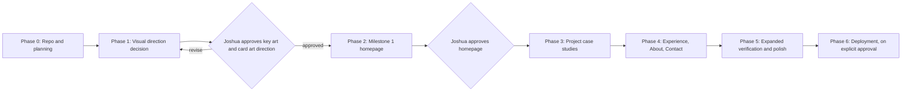

# Implementation Plan

Status: planning complete, implementation not started. Each phase ends with a review by Joshua before the next one begins.

## Recommended stack

| Concern | Choice | Reason |
|---------|--------|--------|
| Framework | Next.js (App Router), latest stable at scaffold time | Static rendering by default, built-in image optimization and art direction support, `next/font` self-hosting, metadata and Open Graph APIs, simple Vercel deployment later |
| UI | React with Server Components by default | Only the mobile menu and small interactive pieces need client JavaScript |
| Language | TypeScript, `strict: true` | Typed content models catch missing project fields at build time |
| Styling | Tailwind CSS v4 with design tokens in `@theme` | Tokens from `docs/design.md` live in one CSS file; utilities keep components short; custom variants handle the short-height layout |
| Content | Typed TypeScript modules validated with Zod (Milestone 1); MDX for case study bodies (Phase 3) | Content stays separate from components, and missing data is explicit (`null`) instead of invented |
| Motion | CSS transitions and keyframes driven by tokens | Enough for the planned motion; one global reduced-motion block. Add a motion library only if a later interaction actually requires it. |
| Testing and verification | Playwright (Chromium first) | Rendered screenshots at fixed viewports, keyboard flows, and reduced-motion emulation in one tool |
| Quality | ESLint (Next config), Prettier, `tsc --noEmit` | Standard and low-maintenance |
| Package manager | npm (already installed: Node 22, npm 10) | Avoids extra setup; switch to pnpm later only if there is a reason |
| Hosting (later) | Vercel | Deferred until Joshua explicitly approves deployment |

### Does anything need 3D or WebGL?

No. The cinematic quality in the references comes from rendered key art plus layered translucent UI, and both are delivered here as optimized images and CSS. WebGL would add bundle weight, battery cost, GPU variability, and extra reduced-motion and fallback work, without improving how a recruiter reads the page.

3D tools are still useful **offline**: Blender is the recommended way to produce the emblem-led key art (see `docs/assets.md`, A1). The output is a static image.

Reconsider real-time WebGL only if, after the static key art ships, Joshua specifically wants an interactive element (for example, light that follows the cursor), and only as a progressive enhancement that is disabled under reduced motion and replaced by the static image when unsupported.

## Phase overview



## Phase 0: Repository and planning (this pull request)

- `.gitignore`, `README.md`, `AGENTS.md`, `docs/design.md`, `docs/implementation-plan.md`, `docs/assets.md`.
- No application code.

## Phase 1: Visual direction decision

Goal: settle the cinematic background and project art **before** building homepage components, so the layout is designed around real imagery and not around procedural decoration.

Steps:

1. **Decide directions.** Joshua picks the key art direction (emblem-led, environment-led, or portrait-led) and the card art approach (real captures, emblems, or mixed). See `docs/assets.md`, A1 and A2.
2. **Scaffold the minimum.** Create the Next.js, TypeScript, and Tailwind project; add the fonts and the color, type, and spacing tokens from `docs/design.md`. No components yet.
3. **Produce two or three composition candidates.** Rough key art at the specified desktop and mobile crops (quick Blender blockouts, graded stock, or rough studies), following the focal point, safe zone, and value rules in A1.
4. **Build a composition study route** (`/lab/composition`, development-only, excluded from production builds). It places each candidate behind:
   - the typeset name and role line at final size,
   - three plain card silhouettes at final size and position,
   - the top bar as a flat bar.
5. **Capture and compare.** Screenshot each candidate at 1440 x 900, 1280 x 720, and 390 x 844. Put the screenshots side by side with references 03 (Rank Legacy), 05 (Agents), and 10 (Premier hub). Measure hero text contrast over each candidate.
6. **Gate.** Joshua approves one candidate, or asks for a revision. The approved image (final or a composition-matched stand-in) and its crop positions are recorded in `docs/assets.md`.

Exit criteria: an approved A1 image or stand-in at both crops, an approved A2 approach with at least one sample card image, and hero text contrast of at least 4.5:1 measured in the safe zone.

## Phase 2: Milestone 1, the homepage

Goal: one polished homepage with functional navigation, featured project cards, and a mobile layout. This is the first real milestone and is intentionally small.

### Scope

In scope:

- Global shell: SkipLink, TopBar (BrandSlab, NavTabs, résumé action, social icon links), StatusStrip, Footer.
- Homepage: Backdrop (approved art with `<picture>` art direction, grain, ghost type), Hero identity block, three-card Lineup, short Experience snapshot, short About teaser, Contact panel.
- Mobile menu as a modal dialog.
- Navigation that works: `/projects`, `/experience`, `/about`, `/contact`, and `/projects/[slug]` exist as minimal pages inside the shared shell. They contain only confirmed facts and a clear "in progress" note.
- Motion and the reduced-motion contract from `docs/design.md`, Section 8.

Out of scope: full case studies, full inner pages, analytics, contact form backend, deployment, and expanded verification (Phase 5).

### Planned structure

```
src/
  app/
    layout.tsx              # fonts, metadata, shell
    globals.css             # Tailwind import, @theme tokens, motion tokens, reduced-motion block
    page.tsx                # homepage
    projects/page.tsx
    projects/[slug]/page.tsx
    experience/page.tsx
    about/page.tsx
    contact/page.tsx
  components/
    shell/                  # SkipLink, TopBar, BrandSlab, NavTabs, MobileMenu, StatusStrip, Footer
    home/                   # Backdrop, Hero, Lineup, ExperienceSnapshot, AboutTeaser, ContactPanel
    ui/                     # Button, Panel, Tag, ProjectCard, SectionHeading
  content/
    schema.ts               # Zod schemas: Profile, Project, ExperienceItem
    profile.ts              # name, affiliations, links (null until confirmed)
    projects.ts             # Hermes, Recolm, Valorant ML (confirmed descriptions only)
    experience.ts
public/
  art/                      # optimized exports of approved art
  resume/                   # résumé PDF once supplied
tests/
  e2e/
    screenshots.spec.ts
    keyboard.spec.ts
    reduced-motion.spec.ts
playwright.config.ts
```

Content rule: fields that Joshua has not confirmed are `null`, and components omit them. The résumé button renders only when the PDF exists; until then the Contact panel lists the résumé as "available on request". Joshua approves that wording.

### Task order

1. Content schemas and the confirmed content entries.
2. Shell: SkipLink, TopBar with NavTabs (active state from the current route), Footer.
3. Backdrop with approved art, scrims, grain, and ghost type.
4. Hero identity block and buttons.
5. ProjectCard and Lineup, including hover, focus, and selected states.
6. Below-the-fold sections.
7. Short-laptop overrides (height-based custom variant).
8. Mobile layout and MobileMenu (native `<dialog>` with `showModal()`).
9. Motion tokens, entrance sequence, and the global reduced-motion block.
10. Stub routes.
11. Verification (below), fixes, and the review package.

### Acceptance criteria

- At 1440 x 900 and 1280 x 720, the name, role line, primary actions, and all three full cards are visible without scrolling.
- At 390 x 844, there is no horizontal scrolling, the hero and the first card's title are reachable within one scroll, and the menu works.
- Every nav item and card link resolves to a real page; the active tab is marked with `aria-current="page"`.
- No invented content: every displayed fact traces to `src/content` and was confirmed by Joshua.
- `npm run build`, `npm run lint`, and `npm run typecheck` pass.
- The verification checks below pass, and the screenshots are reviewed by Joshua.

## Verification for Milestone 1

Initial verification is intentionally focused on four areas. Broader coverage comes after the visual direction is approved (Phase 5).

### 1. Rendered screenshots (three viewports)

Playwright on Chromium, run against a production build (`npm run build && npm run start`), with fonts loaded and images decoded before capture.

| Name | Viewport | Captures |
|------|----------|----------|
| Desktop | 1440 x 900 | Fold, full page, card hover, card focus |
| Short laptop | 1280 x 720 | Fold, full page |
| Mobile | 390 x 844 | Fold, full page, menu open |

Each capture is taken twice: default motion (after the entrance completes) and `reducedMotion: 'reduce'`. Approved screenshots are saved to `docs/verification/milestone-1/` and linked in the pull request.

### 2. Comparison with the references

The references are compared by eye, side by side, not by pixel diff (the goal is equal care, not imitation). Joshua scores each item pass or needs work:

| Check | Compare against |
|-------|-----------------|
| One clear focal point; the eye moves from name to lineup | 03 Rank Legacy, 10 Premier hub |
| Background has readable depth (at least three planes) and atmosphere | 03, 05 Agents |
| Top bar hierarchy: brand slab, then tabs, then actions; the active tab is unmistakable | Top bar in all references |
| Panel geometry: hairlines, square or notched corners, translucency, no heavy shadows | 01 Collection, 02 Rank Overview |
| Tall cards feel like the lineup or player cards and have a clear selected state | 01 player card, 06 Agent Mastery |
| Accent discipline: teal for state, gold thin, coral rationed | 07 Store, 09 Esports, 10 |
| Type: condensed display with a confident scale; labels in small spaced caps; body remains readable | 03, 07 |
| The page still reads as a professional portfolio within ten seconds | Not a game reference; this is a recruiter's read |

### 3. Keyboard navigation

Automated in `tests/e2e/keyboard.spec.ts` and confirmed manually once:

- The first Tab press reveals the skip link; activating it moves focus to `main`.
- Tab order follows the visual order: brand, five nav tabs, résumé, social links, hero actions, three cards, then the sections below.
- Every focused element shows the 2px teal ring, which is not clipped by angled shapes (checked in the focus screenshots).
- Enter activates links, and each card navigates to its project page.
- Mobile menu: opens with Enter or Space, focus moves inside, Tab stays inside, Escape closes, and focus returns to the Menu button.
- No keyboard traps anywhere else.

### 4. Reduced-motion behavior

Automated in `tests/e2e/reduced-motion.spec.ts` with a Playwright context using `reducedMotion: 'reduce'`:

- After load, `document.getAnimations()` returns no running animations.
- For the nav tab, button, card, and menu, hovering and focusing produce a computed `transform` of `none`, and every transition duration is 120ms or less.
- The reduced-motion fold screenshot matches the final state of the default-motion screenshot (content, position, and layout are identical; only motion differs).
- With default motion, the entrance sequence finishes within one second, and content is readable with JavaScript disabled.

### Deferred to Phase 5 (after visual approval)

- Automated accessibility scans (axe) and a full contrast audit.
- Lighthouse performance budgets (LCP, CLS) and image weight checks.
- Firefox and WebKit, tablet (768 x 1024), 320px width, 200% zoom, and ultrawide (2560 x 1080).
- Screen reader passes (NVDA and VoiceOver).
- Pixel-diff visual regression baselines.

## Phase 3: Project case studies

- `/projects` index in the lineup style, and `/projects/[slug]` with MDX bodies.
- Case study structure: Problem, My role, Implementation decisions, Evidence (repository, demo, screenshots, diagrams), Outcomes, Links.
- Content-gated: a section renders only when Joshua supplies its content. Recolm waits for client permission.

## Phase 4: Experience, About, Contact

- Experience: match-history-style rows with confirmed roles and dates.
- About: biography, optional headshot, education.
- Contact: confirmed channels only. A contact form is optional and needs a backend decision (form service versus route handler with a provider). It is not started without approval.

## Phase 5: Expanded verification and polish

- Everything listed under "Deferred to Phase 5".
- SEO metadata, Open Graph image, favicon set, sitemap, and `robots.txt`.
- Error and 404 pages in the site style.

## Phase 6: Deployment

Not started without Joshua's explicit approval. The plan is Vercel with preview deployments for pull requests, with the custom domain to be decided.

## Open questions blocking specific phases

| Question | Blocks |
|----------|--------|
| Key art direction (emblem, environment, or portrait) | Phase 1 |
| Card art approach (captures, emblems, or mixed) | Phase 1 |
| Card order in the lineup | Phase 2 |
| Hero role line wording | Phase 2 |
| Confirmed public links (résumé, email, GitHub, LinkedIn) | Phase 2 (they are omitted until confirmed) |
| Project details and evidence | Phase 3 |
| Recolm client permission | Recolm case study |
| Valorant ML data source and sharing terms | Valorant ML case study |
| License for this repository's code and content | Before deployment |
| Hosting and domain | Phase 6 |
