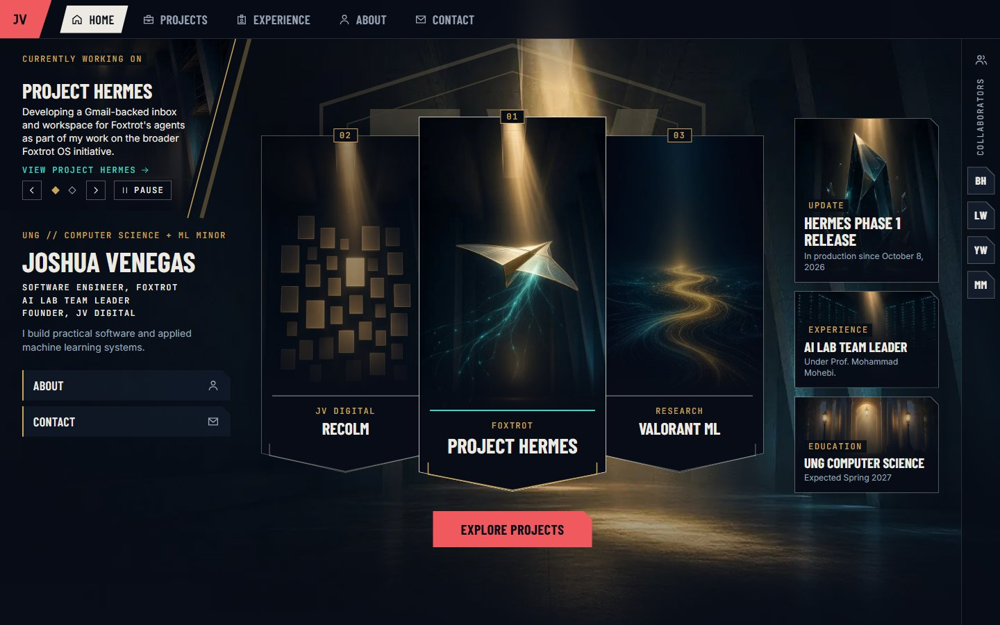
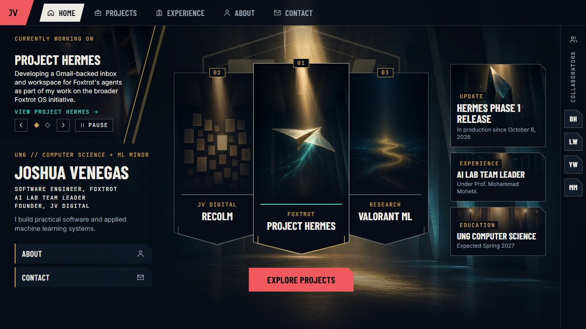
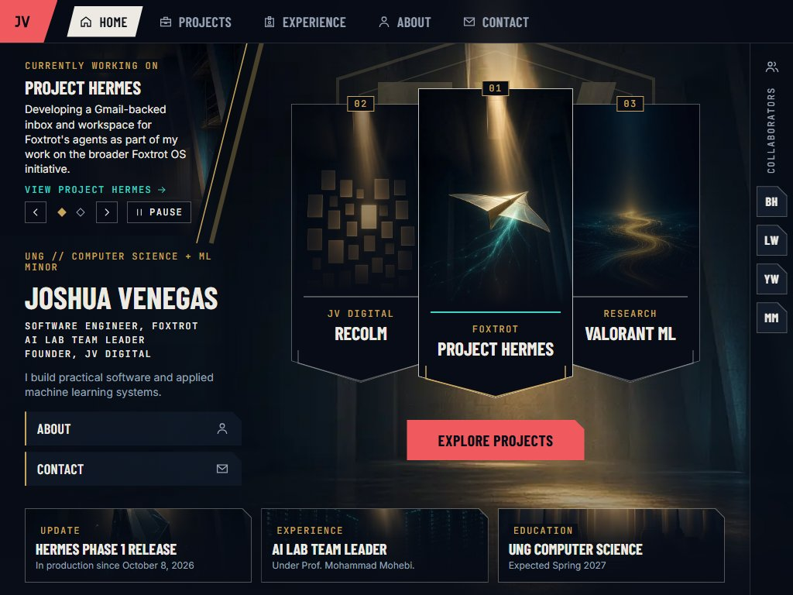
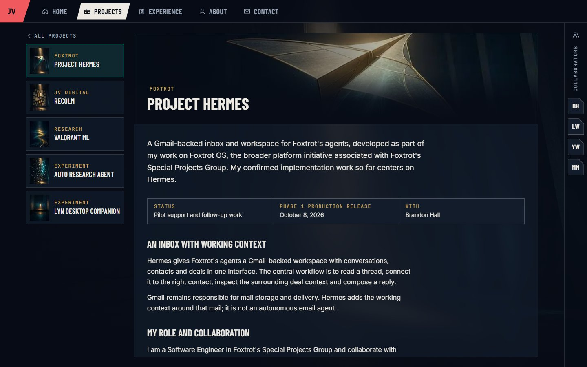
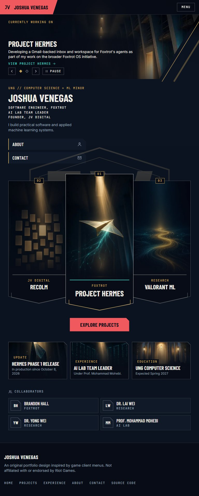
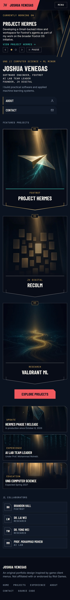
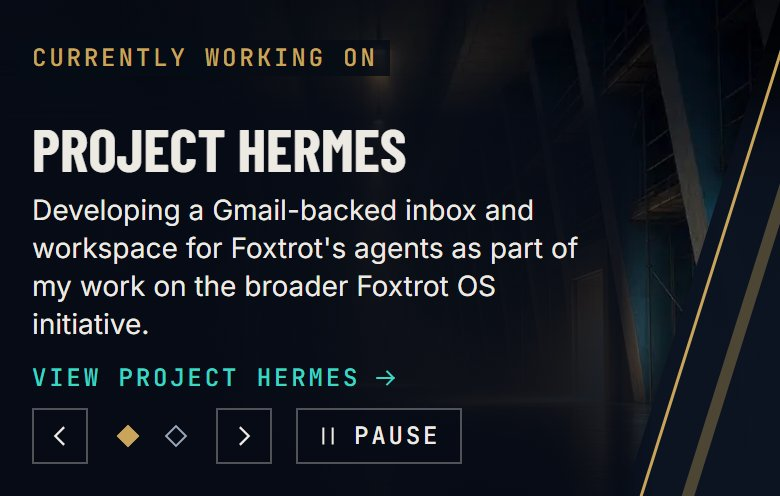
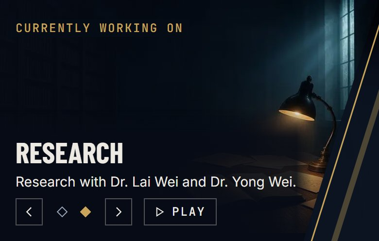
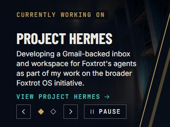
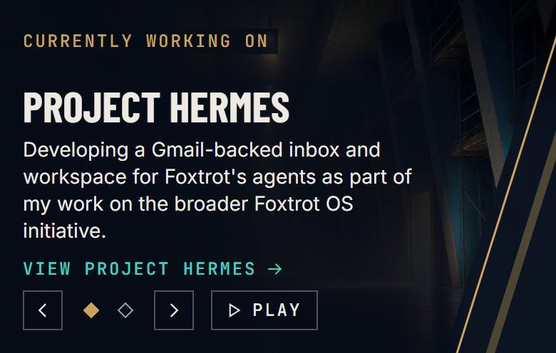

# Lobby shell: verification

October 14 pilot update: captures and contrast reports in this directory are regenerated for the motion and Hermes pilot. The original run narrative below is retained as historical context; current results and limitations are in [the pilot report](../motion-pilot/README.md). Hermes now has a substantial narrative, and the original in-progress note remains only on the other project pages.

The homepage is now the lobby shell that Joshua approved as a desktop composition (`docs/design.md`, Section 3.6). The top bar, collaborator rail, and background persist, and the navigation swaps the lobby, Projects, case study, Experience, About, and Contact views at their own URLs. Everything here is produced by `npm run test:e2e` against a fresh production build, in Playwright 1.64.0's Chromium 156.0.8078.4.

| Lobby, 1440 x 900 | Lobby, 1280 x 720 |
|---|---|
|  |  |

| Lobby, 1024 x 768 | Case study, 1440 x 900 |
|---|---|
|  |  |

| Tablet, 768 x 1024 (full page) | Mobile, 390 x 844 (full page) |
|---|---|
|  |  |

The "Currently working on" carousel, both slides with their controls. In default motion it is rotating, so the control reads Pause; choosing the Research slide stops it, so that capture reads Play. Under reduced motion it starts paused.

| Project Hermes, 390 x 844 | Research, 390 x 844 |
|---|---|
|  |  |

| Project Hermes, 1440 x 900 | Project Hermes, 390 x 844, reduced motion |
|---|---|
|  |  |

Also captured:

- The lobby at 1920 x 1080 (`home-wide-*`), in default and reduced motion at every size.
- Both carousel slides at 1440 x 900 and 390 x 844 in both motion settings (`carousel-*`).
- On desktop, pennant hover and focus, the second carousel slide, and the Brandon Hall popover. On mobile, a collaborator popover and the menu.
- Each view (`projects-*`, `project-hermes-*`, `experience-*`, `about-*`, `contact-*`) at 1440 x 900, 1280 x 720, 768 x 1024, and 390 x 844.

The side-by-side with the Play lobby reference is kept locally only, because the reference is Riot artwork.

## Results: 121 of 121 tests pass

`npm run lint` and `npm run typecheck` pass. On Windows, a run can fail to overwrite an image or report that another process briefly holds open (`UNKNOWN: unknown error, open`). That is a file-write error, not an assertion; clearing `docs/verification/lobby/*.jpg` and `*.json` before the run avoids it.

- **Layout** (`layout.spec.ts`, 17 lobby sizes from 1920 x 1080 to 320 x 640, plus every view at six sizes):
  - From 1024px, the document is exactly one viewport tall. In the lobby, `main` does not overflow, so every pennant, tile, the name, and Explore projects sit between the top bar and the bottom edge. Taller views scroll inside `main`; nothing is hidden with `overflow: hidden`.
  - The pennants are seated Recolm, Hermes, Valorant ML from 640px. The flanks are 0.9 of the lead and tuck 16px behind it, and the lead is at least 400px tall. From 1280px the tile column is exactly as tall as the lead pennant.
  - Below 640px, the pennants stack in priority order with Hermes first, after the name.
  - **Glyph containment:** every rendered line of text, measured from its text range rather than its element box, stays inside its nearest block and inside the viewport. The name's ink also ends before the first pennant, which is the check that was missing when "VENEGAS" ran behind Recolm.
  - There is no horizontal scrolling at any size.
- **Keyboard** (`keyboard.spec.ts`):
  - The skip link comes first. The lobby's tab order runs: brand, tabs, the carousel link, arrows, indicators, and Pause, About and Contact, the pennants (Hermes first), Explore projects, the tiles, then the four collaborators. Every stop has an unclipped 2px teal ring.
  - The carousel arrows and indicators change the slide with Enter, and the hidden slide is `inert`.
  - A collaborator popover opens with Enter, shows the relationship, and fits the viewport. It has no online status, and Escape closes it and returns focus to its button.
  - Each tab replaces the stage, marks itself `aria-current="page"`, and keeps the rail; browser Back walks the views in reverse.
  - The case study scrolls inside its reading panel (End key) while the top bar stays fully visible.
  - The mobile menu traps focus, closes with Escape, restores focus, and navigates. A collaborator in the mobile strip opens a centered popover.
- **Carousel rotation** (`carousel.spec.ts`, on Playwright's fake clock, paused once the page settles, with every pending rotation timer tracked):
  - It advances after 8 seconds (not 10ms before) and wraps, and automatic changes leave the live region empty.
  - The pointer over it, keyboard focus inside it, and a hidden page (`visibilitychange`) each hold it with no timer pending; 24 seconds pass without a change. When that ends, a fresh 8-second timer starts.
  - Pause, from the mouse or with Enter and Space, stops it until Play. An arrow or indicator also stops it, and the live region announces "Slide 2 of 2: Research" or "Slide 1 of 2: Project Hermes".
  - Under reduced motion it starts paused (the control reads Play). A slide change is a 120ms opacity fade with no movement, and Play still works.
  - On both slides, only the active slide's link is in the tab order, followed by the arrows, indicators, and Pause or Play. Leaving the lobby clears the timer.
- **Reduced motion** (`reduced-motion.spec.ts`): no animation runs after load. Hovering or focusing the tabs, pennants, Explore projects, tiles, a collaborator, a carousel arrow, or Pause/Play changes no geometry, and no transition lasts over 120ms. The clip-path shapes and the layout match default motion. The entrance finishes within one second, and the content is readable without JavaScript.
- **Contrast** (`contrast.spec.ts`): the minimum WCAG ratio between each rendered line's color and every background pixel in its box, with glyphs hidden. Lines scrolled out of a panel are cropped to what is on screen. On the lobby, both carousel slides are measured in turn, and the carousel's arrow and Pause/Play icons and its indicators are held to the 3:1 non-text minimum against the pixels behind them. Each report records the browser version. Zero failures across all 16 runs:

| View and size | Measured | Lowest |
|---|---|---|
| Lobby, 1920 / 1440 / 1280 | 107 each (both slides) | "Hermes Phase 1 release" (large), 4.04:1 against 3:1 at 1280; 6.83:1 or higher otherwise |
| Lobby, 1024 x 768 | 104 | "Contact", 6.89:1 |
| Lobby, tablet / mobile | 52 each | 7.52:1 / 7.42:1 |
| Carousel text, every lobby size | | "View Project Hermes", 10.21:1 or higher; the Project Hermes description, 14.38:1 or higher on mobile |
| Carousel controls, every lobby size | | Inactive indicator, 7.89:1 |
| Project Hermes, desktop / mobile | 45 / 20 | 6.62:1 / 7.15:1 |
| Experience, desktop / mobile | 48 / 33 | "Research" label, 5.06:1 / 6.95:1 |
| Projects, About, Contact | 9 to 37 | 6.47:1 or higher |

### The mobile carousel finding

Codex's review of `be2caae` (Chromium 153, 390 x 844 at DSF 2, reduced motion) measured the carousel line "Building and supporting Project Hermes with Foxtrot." at 1.82:1 against 4.5:1, three times. Here the same commit measured 8.99:1 in Chromium 156, so the failure did not reproduce, and the cause of the difference is not confirmed. Either way, the text relied on the art being dark at that spot.

The fix removes that dependence rather than adjusting the test. Each slide's text now sits on a dark backing (`scrim-text` in `src/app/globals.css`, 86% of the deep background). It covers the title, description, link, and the controls beneath them, fades in above the title, and fades out past the longest line, so the art stays visible to the right and above. The requirement is still 4.5:1 per line against every pixel. The new mobile description lines measure 14.38:1 to 16.27:1, and the lowest carousel line anywhere is 10.21:1. This has not been rerun in Chromium 153.

The longer Project Hermes description also needed room. The carousel is 248px tall at every size, its text column narrows to stay inside the diagonal cut at 768px, and from 1024 to 1279px the slide title is smaller and the gap above About and Contact is 16px. The gold rules extend 4% past the panel instead of 8%, so they end above the gold eyebrow. At 1024 x 768 the lobby still fits one viewport with 9px to spare.

Two earlier issues these tests caught, both fixed:

- **The tile column was sized against the viewport.** The tiles sat outside the stage's size container, so at 1280 x 1024 they were 97px shorter than the lead pennant. The lobby is now the container, and `--pennant-h` is written against its columns.
- **The "Research" label failed contrast at 4.06:1.** It sat in the light shaft on Experience. The background dim for views other than the lobby went from 60% to 70%.

## Content shown, and what stays unset

Every visible fact comes from `src/content`. Unset fields are not rendered.

- **Roles:** Software Engineer at Foxtrot, in the Special Projects Group (the title from the offer letter; its compensation, terms, and listed systems are not recorded); AI Lab team leader under Prof. Mohammad Mohebi; founder of JV Digital; UNG computer science with an ML minor, expected Spring 2027.
- **Foxtrot OS and Project Hermes:** the Experience row and the case study explain that Foxtrot OS is the broader platform initiative associated with Joshua's work in the Special Projects Group, and that his confirmed implementation work so far centers on Project Hermes. The Experience row lists his seven confirmed Hermes contributions in his wording. Nothing claims the rest of Foxtrot OS or the other systems the offer letter names. The lobby slide is titled Project Hermes and links to `/projects/project-hermes`.
- **Case studies:** each shows the description, status, milestones, collaborators, Joshua's own contributions (or, for the two experiments, what the experiment involves), and the stack, with a "Full case study in progress" note. No metrics, outcomes, or claims beyond what Joshua supplied.
- **Research:** "Research with Dr. Lai Wei and Dr. Yong Wei", marked as details in progress. The title, responsibilities, methods, deliverables, and milestone are unset.
- **Collaborators:** Brandon Hall, Dr. Lai Wei, Dr. Yong Wei, and Prof. Mohammad Mohebi, each of whom agreed to be listed. Initials only; there are no portraits, biographies, links, or online status.
- **Not shown:** résumé, email, GitHub, LinkedIn, role dates, outcomes, and the Recolm client's name (pending written permission).

## Artwork

The pennant, carousel, tile, and case study images are the A2-lobby art (`docs/assets.md`), approved to ship for now. Before deployment, the generating tool's terms and Joshua's acceptance of the copyright caveat still need to be recorded. The images are illustrative and contain no interfaces, data, logos, or game imagery.

## Not built

- Full case studies (Phase 3), which need the content listed in `docs/assets.md`.
