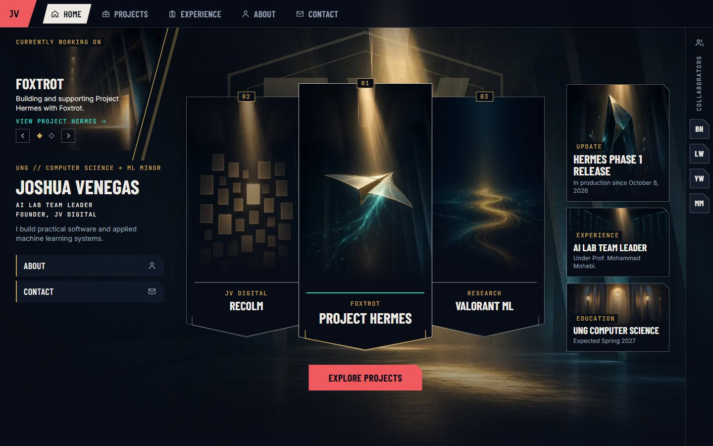
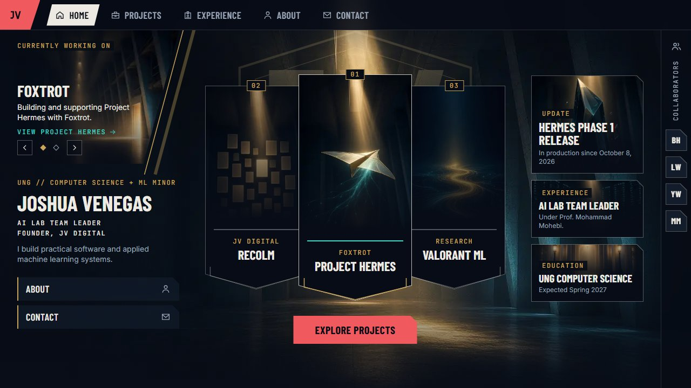

# Lobby shell: revised desktop composition

The desktop lobby from Joshua's review of Milestone 1, at `/lab/lobby` (development only). It keeps the approved Atrium background as interim art. Tab views, the mobile and tablet versions, and the swap onto `/` wait for approval (`docs/design.md`, Section 3.6).

| 1440 x 900 | 1280 x 720 |
|---|---|
|  |  |

Also: `lobby-1920x1080.jpg`, the collaborator popover (`lobby-1440x900-collaborator.jpg`), and the second carousel slide (`lobby-1440x900-slide2.jpg`). The side-by-side with the Play lobby reference is kept locally only, because the reference is Riot artwork.

## Checks (development server, Chromium, reduced motion)

- **Fits one viewport** at 1280 x 720, 1440 x 900, and 1920 x 1080: page scroll height equals the viewport and nothing is hidden with `overflow: hidden`. Cards and tiles lie between the top bar and the bottom edge.
- **Glyph containment:** every rendered line of text (measured from its text range, not the element box) stays inside its container and the viewport. The name's ink ends at 281px, and the first pennant starts at 376px (1440) or 380px (1280). This is the check that was missing when "VENEGAS" ran behind Recolm.
- **Text contrast,** using the same per-line minimum method as `tests/e2e/contrast.spec.ts`: 46 lines at each size, with zero failures. The lowest is "View Project Hermes" at 5.68:1, and the large "Hermes Phase 1 release" title is 4.04:1 at 1280 x 720 (3:1 required). Small labels over artwork sit on a dark plate.
- **Regression:** the Milestone 1 homepage's layout, keyboard, and reduced-motion specs still pass (30 of 30) with the updated content.

These checks ran as scripts against the development route. They become Playwright specs when the lobby replaces the homepage, since lab routes return 404 in production builds.

## Content shown, and what stays unset

Every visible fact comes from `src/content`. Unset fields are not rendered.

- **Currently working on:** "Building and supporting Project Hermes with Foxtrot." and "Research with Dr. Lai Wei and Dr. Yong Wei." The research project title, responsibilities, methods, deliverables, and milestone are unset.
- **Pennants:** title and context label only (Foxtrot, JV Digital, Research). Summaries move to the project view.
- **Tiles:** the Hermes Phase 1 release (October 8, 2026), the AI Lab team leader role under Prof. Mohammad Mohebi, and UNG computer science (expected Spring 2027).
- **Collaborators:** Brandon Hall (Foxtrot), Dr. Lai Wei and Dr. Yong Wei (research), Prof. Mohammad Mohebi (AI Lab). Initials only; portraits, biographies, and links are unset; there is no online status.
- **Not shown:** résumé, email, GitHub, LinkedIn, role dates, outcomes, and the Recolm client's name (pending written permission).

## Artwork

The pennant, carousel, and tile images are AI-generated study art (`docs/assets.md`, A2-study-lobby). They are illustrative and contain no interfaces, data, logos, or game imagery. Shipping them needs Joshua's decision; otherwise they stand in until sanitized Hermes captures, Recolm captures (with client permission), Valorant ML charts from real outputs, and owned art exist.

## Not built yet

- Navigation-controlled views (Projects, Experience, About, Contact inside the shell, with linkable URLs and working Back).
- Scrolling reading panels for case studies.
- Optional slow carousel rotation (pause on hover and focus, off under reduced motion).
- Mobile and tablet versions.
- Replacing the below-the-fold homepage sections.
