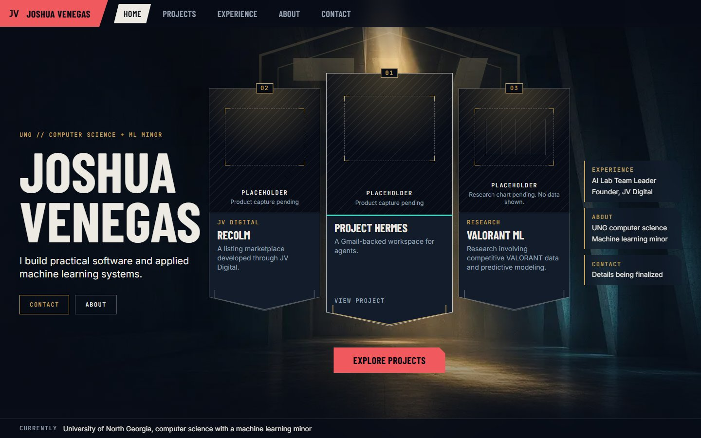
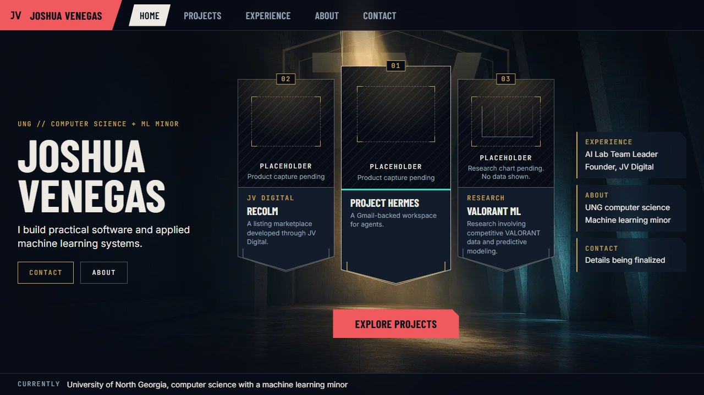
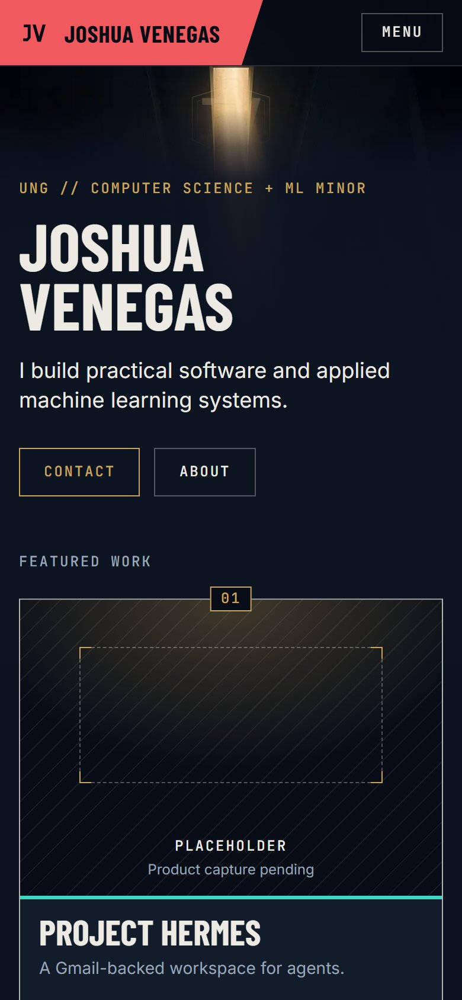
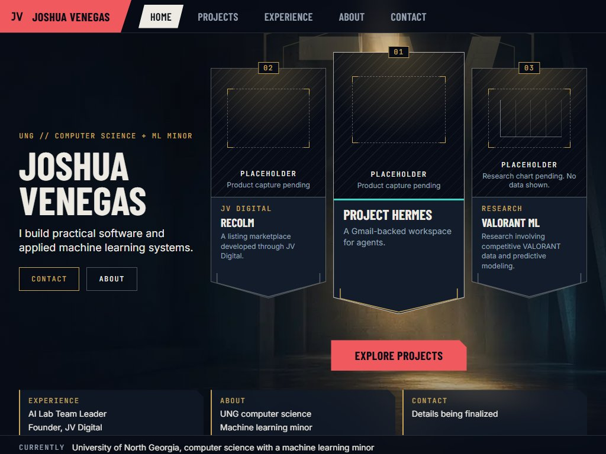
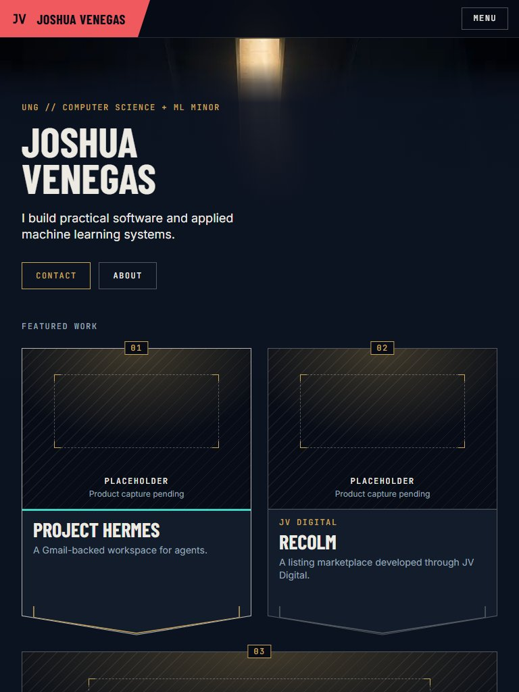

# Milestone 1: homepage verification

Candidate A (Atrium) with its interim background art. Every capture and check below runs against a production build (`npm run test:e2e`: `next build`, `next start` on port 3200, Playwright on Chromium). The run always starts its own server; if port 3200 is already in use, it fails rather than testing whatever is listening there.

Latest run: 45 tests pass (screenshots 10, keyboard 6, reduced motion 7, contrast 5, layout 17). The keyboard, reduced-motion, and layout specs also passed 150 of 150 with `--repeat-each=5`.

## Screenshots

First viewport, default motion (after the entrance finishes):

| Desktop 1440 x 900 | Short laptop 1280 x 720 | Mobile 390 x 844 |
|---|---|---|
|  |  |  |

| Compact desktop 1024 x 768 | Tablet 768 x 1024 |
|---|---|
|  |  |

Reduced motion: `home-{desktop,laptop,compact,tablet,mobile}-reduced.jpg`. Layout, shapes, and color match the default-motion final state; only movement is removed.

States and full pages:

- Card focus (keyboard) and hover: `home-desktop-{default,reduced}-card-focus.jpg`, `home-desktop-{default,reduced}-card-hover.jpg`. With default motion the card lifts 4px; with reduced motion it stays in place and only the color changes.
- Mobile menu open: `home-mobile-{default,reduced}-menu.jpg`.
- Full pages: `home-{desktop,laptop,compact,tablet,mobile}-{default,reduced}-full.jpg`.

## Fixes from the review of `df0f71a`

- **Desktop clipping.** At 1024 x 768 the tiles were mostly off-screen, and at 1100 x 900 they disappeared and Valorant ML was cut off, with hidden overflow preventing scrolling. Now:
  - Card height also depends on the lineup column's width, so the three cards always fit their column.
  - 1024 to 1279px uses a compact lobby with the tiles in a row beneath, and the three-column lobby starts at 1280px.
  - The fold no longer hides overflow.
  - `layout.spec.ts` asserts that cards and tiles stay inside the viewport at 17 sizes.
- **Reduced-motion false positive.** The test rejected the brand slab's permitted 120ms brightness transition when the pointer started over it. It now rejects keyframe animations, transitions of position or size, and anything longer than 120ms, and a regression test rests the pointer on the slab.
- **Server reuse.** Playwright sets `reuseExistingServer: false`, so every run builds and serves its own production copy.
- **Tablet.** From 640 to 1023px, cards use the documented two-column grid; Valorant ML spans both columns at 8:5, matching the height of the row above. `/projects` uses the same arrangement.
- **Found by the new layout spec.** At 320px wide, the "View project" cue overlapped the summary. Card text now sizes from the card's own width, and the cue appears only on cards at least 240px wide and 440px tall. As a result, the flank cards at 1440 x 900 no longer show the cue.

## Responsive layout (`tests/e2e/layout.spec.ts`): pass

17 viewports: 1920 x 1080, 1536 x 864, 1440 x 900, 1366 x 768, 1280 x 1024, 1280 x 720, 1279 x 900, 1100 x 900, 1024 x 768, 1024 x 1366, 1023 x 768, 820 x 1180, 768 x 1024, 640 x 960, 639 x 900, 390 x 844, 320 x 640.

- No horizontal scrolling at any size. Cards, tiles, the name, and the primary action are inside the viewport and not clipped by an overflow ancestor.
- Card text ends at least 28px above each card's bottom edge.
- 1024px and up: Recolm, Hermes, Valorant ML left to right, 1:2 cards, lead at least 400px tall, no overlap between identity, lineup, and tiles. From 1280px, everything fits between the top bar and the status strip; from 1024 to 1279px, the tiles sit in one row under the lineup.
- 640 to 1023px: two columns with Valorant ML spanning below. Below 640px: stacked, Hermes first.

## What changed at the Phase 1 gate

- **Desktop lineup preserved:** Recolm left, Hermes center (raised lead), Valorant ML right.
- **Hermes first on mobile, through document order.** The lineup is an ordered list in featured order (Hermes, Recolm, Valorant ML). Desktop CSS `order` seats Hermes in the center. Keyboard and screen reader order is Hermes, Recolm, Valorant ML on every viewport; the index badges show that order (the desktop row reads 02, 01, 03).
- **Shorter mobile art band:** the name now starts about 100px below the top bar (the Phase 1 study used about 230px). The first card's title is visible in the first mobile screen.
- **Kept:** the Experience, About, and Contact tiles (desktop panel stack, now real links) and the subtle JV emblem (behind the lineup on desktop, in the art band on mobile).

## Representative card review

Hermes was built first and reviewed inside the full composition before the rest of the page. Two changes came out of that review:

1. The placeholder art area read as flat black against the lit hall. It now carries a warm glow from the top that echoes the key light, over a faint hatch, with an empty dashed capture frame and gold corner ticks. The "Placeholder" label and what is pending ("Product capture pending", or "Research chart pending. No data shown." with empty axes) stay visible. Nothing imitates a product interface or shows data.
2. The 1:2 lead card had an empty band under the summary. A "View project" cue now sits at the bottom of cards that have room for it (at least 240px wide and 440px tall).

A later pass raised the capture frame, because on short-laptop flank cards the "Placeholder" label touched the frame edge.

## Keyboard (`tests/e2e/keyboard.spec.ts`): pass

- The first Tab shows "Skip to content"; Enter moves focus to `main`.
- Desktop tab order: skip link, brand, Home, Projects, Experience, About, Contact, hero Contact, hero About, Hermes, Recolm, Valorant ML, Explore projects, then the Experience, About, and Contact tiles. Résumé and social links are omitted until confirmed.
- Every stop shows a 2px teal outline. No ancestor applies a `clip-path` to it, and no overflow container cuts it.
- Enter on the Hermes card opens `/projects/project-hermes`.
- Each nav tab returns 200 and is the only tab with `aria-current="page"` on its route.
- Mobile menu: opens with Enter or Space, focus starts inside, Tab wraps within the dialog (the native modal dialog would otherwise let focus leave for the browser UI), Escape closes it and focus returns to the Menu button, and a menu link navigates and closes the dialog.

## Reduced motion (`tests/e2e/reduced-motion.spec.ts`): pass

- Nothing that moves runs after load: no keyframe animations, no transitions of transform, position, or size, and no transition longer than 120ms. Short color, opacity, and filter transitions are allowed; with the pointer resting on the brand slab, only its 120ms brightness transition runs.
- Hovering or focusing a nav tab, the hero Contact button, the Hermes card, "Explore projects", and a panel tile leaves the boxes of the element and every descendant unchanged (no lift, slide, or zoom). Every transition is 120ms or less.
- Opening the mobile menu starts no keyframe animation and no transform transition.
- The computed `clip-path` of every angled element, and the boxes of the name, all three cards, "Explore projects", and the panel stack, are identical with and without reduced motion.
- With default motion, the entrance finishes within one second (the longest is 920ms), and with JavaScript disabled the name and all three cards are visible at full opacity.

## Text contrast at actual positions (`tests/e2e/contrast.spec.ts`): pass

Method: for each rendered line of text in the first viewport, the test takes the line's box and its computed text color (including any opacity). It captures the same viewport with only the glyph fill hidden, then computes the WCAG ratio against every background pixel inside that box and keeps the minimum. The requirement is 4.5:1, or 3:1 for large text. This is a strict worst case per line. It replaces the Phase 1 figure, which was the 98th-percentile luminance across the whole safe-zone box.

| Viewport | Lines checked | Failures | Lowest line (minimum ratio) | Hero name | Headline | Eyebrow |
|---|---|---|---|---|---|---|
| Desktop | 49 | 0 | Hero "Contact" button, gold, 6.47:1 | 15.67:1 | 15.78:1 | 8.15:1 |
| Short laptop | 49 | 0 | "Contact" nav tab, muted, 6.84:1 | 15.63:1 | 15.67:1 | 8.15:1 |
| Compact desktop | 49 | 0 | Hero "Contact" button, gold, 6.09:1 | 15.67:1 | 15.67:1 | 8.19:1 |
| Tablet | 24 | 0 | Placeholder note, muted, 6.92:1 | 15.46:1 | 15.34:1 | 7.91:1 |
| Mobile | 16 | 0 | Placeholder note, muted, 6.92:1 | 15.03:1 | 15.33:1 | 6.98:1 |

Per-line results: `contrast-{desktop,laptop,compact,tablet,mobile}.json`. The results must be re-run when the final art replaces the interim asset.

## Reference comparison (for Joshua to score)

| Check | Compare against | Score |
|---|---|---|
| Lobby composition: identity left, raised lead card in a set-back lineup, panel stack right, one primary action below | 00 Play lobby | |
| One clear focal point; the eye moves from name to lineup | 00, 03 | |
| Background has readable depth and atmosphere | 03, 05 | |
| Top bar hierarchy: brand slab, then tabs, then actions; the active tab is unmistakable | All | |
| Panel geometry: hairlines, notched corners, translucency, no heavy shadows | 01, 02 | |
| Tall cards feel like lineup cards and have a clear selected state | 00, 01 | |
| Accent discipline: teal for state, gold thin, coral rationed | 07, 09, 10 | |
| Type: condensed display, small spaced caps labels, readable body | 03, 07 | |
| The page reads as a professional portfolio within ten seconds | Recruiter's read | |

## Known limitations

- **Interim art.** The background is the 1280 x 720 (desktop) and 720 x 1280 (mobile) Phase 1 image and looks soft on large screens. Final resolution is handled during refinement.
- **Placeholders.** No product captures or research charts exist yet, so all three cards show labelled placeholders.
- **Omitted links.** Résumé, email, GitHub, and LinkedIn are not shown because none is confirmed. The Contact page says so instead of showing disabled buttons.
- **Unknown project slugs** (for example `/projects/unknown`) render the not-found UI with status 200, because the page streams and `dynamicParams = false` is not available with Cache Components. Proper 404 handling belongs to Phase 5.
- **Inner pages** contain only confirmed facts and an "in progress" note.
