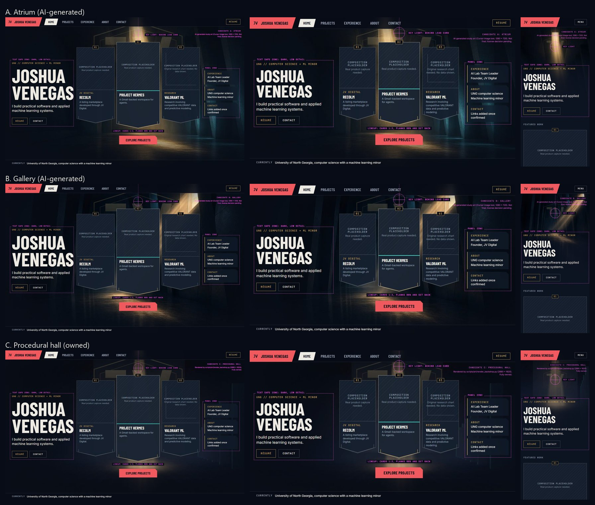
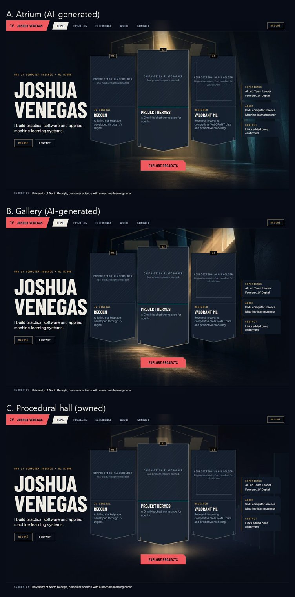

# Phase 1: Composition study results

Three background candidates rendered behind the same layout, typography, and card positions, so only the artwork varies. Primary reference: the VALORANT Play lobby (reference 00, local only).

Fixed across all candidates: the identity block, the lineup (Recolm left, Hermes center as the raised lead card, Valorant ML right), the panel stack, the "Explore projects" action, the scrims, the grain, and the JV emblem at about 20% opacity behind the lineup.

Guide overlays (magenta, study only) mark the text safe zone, the panel zone, the key light target, and the lineup proportions.

## Comparison

All candidates with guides (desktop 1440 x 900, short laptop 1280 x 720, mobile 390 x 844):



Desktop without guides:



Individual captures: `candidate-{a,b,c}-{desktop,laptop,mobile}-guides.jpg` and `candidate-{a,b,c}-desktop-clean.jpg`.

## Hero text contrast

How these numbers were measured: the whole safe-zone box (the area that holds the eyebrow, name, headline, and actions) was captured with the text made transparent. The script took the 98th-percentile relative luminance of all pixels in that box and computed the WCAG contrast ratio of each text color against it. This is an approximation, not a worst case: it ignores the brightest 2% of pixels, and it covers the whole box rather than the positions where the glyphs actually sit (much of the box is empty space between and beside the lines). WCAG AA needs 4.5:1 for this text.

Milestone 1 replaces this with a strict check at the actual text positions: the minimum contrast between each line's text color and every background pixel inside that line's box (`docs/implementation-plan.md`, Verification, section 5).

| Candidate | Viewport | Off-white text `#EDEAE3` | Gold eyebrow `#C9A55C` |
|-----------|----------|--------------------------|------------------------|
| A. Atrium | Desktop | 15.8:1 | 8.2:1 |
| A. Atrium | Short laptop | 15.8:1 | 8.2:1 |
| A. Atrium | Mobile | 12.7:1 | 6.6:1 |
| B. Gallery | Desktop | 15.6:1 | 8.1:1 |
| B. Gallery | Short laptop | 15.4:1 | 7.9:1 |
| B. Gallery | Mobile | 9.4:1 | 4.8:1 |
| C. Procedural hall | Desktop | 15.6:1 | 8.0:1 |
| C. Procedural hall | Short laptop | 15.5:1 | 8.0:1 |
| C. Procedural hall | Mobile | 6.6:1 | **3.4:1 (fails)** |

## Observations

**A. Atrium (AI-generated).** The vertical skylight shaft lands directly behind the Hermes card and stays visible above and around it, so the light frames the lineup the way the lobby's light frames the player card. The angled concrete fins at the right give the strongest depth, and their teal rim light fits the palette. The left side stays dark without a visible scrim edge. The weakness is resolution: the source is 1280 x 720 and looks soft at 1440 wide.

**B. Gallery (AI-generated).** The diagonal beam echoes the lobby's gold streaks, and the reflective floor is dramatic. However, the light source sits at the upper right, over the Valorant ML card and the panel stack, so the brightest point pulls attention away from the lead card. On mobile, the beam crosses the eyebrow line and contrast drops to 4.8:1.

**C. Procedural hall (owned).** The focal point is exactly where the layout wants it, and the asset can be rendered at any size. But the beam is narrower than the lead card and mostly disappears behind it. The scene reads as graphic rather than cinematic. On mobile, the floor pool sits under the eyebrow and fails contrast.

## Comparison against the references

| Check | A | B | C |
|-------|---|---|---|
| One clear focal point that leads from name to lineup (00, 03) | Pass | Needs work: focus drifts right | Needs work: focus is hidden by the lead card |
| Readable depth, at least three planes (00, 05) | Pass | Pass | Partial |
| Atmosphere and light quality comparable to the references | Pass, apart from resolution | Pass | Needs work |
| Text safe zones stay dark | Pass | Pass on desktop; marginal on mobile | Pass on desktop; fails on mobile |
| Emblem subordinate to the lineup | Pass | Pass | Pass, but it becomes the most visible lit element |

Layout checks that apply to all candidates: the name, headline, actions, all three full cards, and "Explore projects" fit within 1440 x 900 and 1280 x 720 without scrolling. On mobile, the art band, identity block, and the start of the first card fit in the first screen.

## Recommendation and decision

**Candidate A, Atrium.** It is the only candidate that passes every check, and its light composition is the closest match to the lobby.

**Decision:** Joshua approved candidate A as the homepage direction. Its current background is an interim asset; final resolution is handled during refinement. Before the final art ships:

1. Decide on the final source (see `docs/assets.md`, A1): ship the upscaled AI image with its terms recorded, use it as a brief for an artist or owned render, or move the procedural renderer toward it.
2. Produce the final art at 2880 x 1620 and 1290 x 2796.
3. Re-run this capture and the contrast measurement with the final art.

## Reproduce

```
npm run dev -- --port 3100
npm run capture:composition
python scripts/art/measure_safe_zone.py
python scripts/art/contact_sheet.py
```

The study routes are `/lab/composition` (index) and `/lab/composition/{a,b,c}/{guides,clean}`. They return 404 in production builds.
